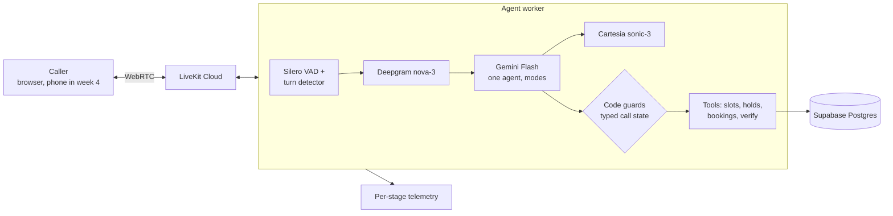

# Hinglish Clinic Voice Agent

A voice receptionist for small Indian clinics. A caller speaks in English or Hinglish, and the agent answers clinic questions, finds free slots, and books, moves or cancels appointments, with real-time speech in both directions.

> **Status: in progress (week 2 of 8).** The voice loop, latency telemetry, clinic data, guarded booking tools and the text eval suite are built. Week 3 adds barge-in and turn-taking work and ships V1. Audio runs in English for now; Hinglish audio comes back in week 4 (the date and time parsing is already bilingual). All data is synthetic.

## What it does today

- **Live voice calls** in the browser through LiveKit Cloud: streaming STT, LLM and TTS, with voice activity detection and a turn-detector model deciding when the caller has finished.
- **Clinic questions** answered only from the database (hours, fees, doctors). It never invents facts.
- **Free-slot search** from a doctor's weekly hours, days off and existing bookings. "Kal shaam", "parson subah" and "next Monday" are turned into dates by code, not by the LLM.
- **Booking, rescheduling and cancelling**, with the safety checks below.
- **Handoff:** medical questions, upset callers and repeated misunderstandings go to a staff callback. The agent gives no medical advice.

## Engineering highlights

**One agent with modes, guarded in code.** A single agent switches between modes: greeting, FAQ, booking, rescheduling, cancelling and handoff. Each mode exposes only its own tools, and every tool checks the typed call state before it runs. A prompt injection such as "cancel all bookings" therefore has no tool to call. Guards live in code, not in the prompt.

**Writes that can't go wrong silently.**
- **Read-back built from the stored row.** Code writes the read-back sentence (doctor, day, time, patient) from the database row and speaks it word for word. A write happens only after a clear "yes" to that exact sentence, heard in full; an interrupted or mixed answer means a re-read. So a "yes" always covers what is actually written.
- **No double bookings.** A partial unique index on (doctor, start time) is the final guard, under 3-minute slot holds that are released when the call ends.
- **Safe retries.** Full-length idempotency keys; writes are never retried blindly, and a timeout is reported as "outcome unknown", not as a failure.
- **Audit trail.** Every change writes an event in the same transaction.

**Caller verification before any personal data.** The caller gives a phone number plus a name or date of birth. Code parses them (including spoken digits such as "double nine" and Hindi number words) and needs an exact match to one patient. A failed attempt doesn't reveal which detail was wrong, and two failures hand the call to staff.

**Latency measured per stage.** One telemetry row per agent reply records end of turn, STT, LLM first token, first sentence, TTS first audio, voice-to-voice and barge-in stop time. It goes to JSONL and Postgres and never blocks the call. Reports give p50/p95, never averages alone. Every change gets a row in [`docs/LATENCY_LOG.md`](docs/LATENCY_LOG.md) next to task success.

**Evals in a sandbox.** 21 scripted multi-turn scenarios (13 dev, 8 held out) run the real agent in text mode against a local Postgres sandbox with a frozen clock. They are scored on outcome, wrong actions and verification violations. A hard switch means eval mode can't connect to anything except the sandbox database.

## Results so far

| Measurement | Setup | Result |
|---|---|---|
| Voice-to-voice latency, baseline (no tools) | English, browser, 10 calls, 22 turns | p50 **2,251 ms** / p95 2,747 ms |
| Voice-to-voice with read-only tools | English, browser, 10 calls, 27 turns | p50 2,781 ms / p95 4,996 ms; 9 of 10 correct, 0 made-up facts |
| Barge-in stop time | same calls | p50 346 ms |
| Booking, reschedule, cancel flows | text evals, dev split | **13 of 13** tasks, 0 wrong actions, 0 verification violations |
| Unit and DB tests | `pytest` | 208 passing |

The voice-to-voice figures are from a desk setup on a browser connection, not a phone line. An experiment that swapped in the cloud turn-detector model showed no improvement and was reverted (written up in [`docs/LEARNING.md`](docs/LEARNING.md)). Voice latency for the week 2 write flows is still to be measured.

## Architecture



The real-time path stays small: nothing in a turn waits on a queue or a workflow engine. Durable work (confirmations, reminders, dropped calls) moves to Temporal in week 5, off the call path.

## Stack

Python 3.12 · uv · LiveKit Agents 1.8 (LiveKit Cloud) · Deepgram nova-3 · Gemini Flash · Cartesia sonic-3 (Sarvam wired as an alternative for Hinglish) · Silero VAD · LiveKit turn detector · Supabase Postgres with asyncpg · pydantic · pytest · ruff

## Roadmap

- [x] **Week 1:** voice loop, per-stage latency telemetry, baseline, clinic data, read-only tools
- [x] **Week 2:** modes and guards, verification, holds, bookings, code read-backs, eval runner *(voice test pending)*
- [ ] **Week 3:** backchannel filter, turn-taking and latency optimization pass, **V1 demo video**
- [ ] **Week 4:** Indian phone number; Hinglish audio, a word-error-rate test set and turn-detection tuning
- [ ] **Week 5:** Temporal workflows for confirmations, reminders and dropped calls; WhatsApp or SMS
- [ ] **Week 6:** 40+ scenarios, audio-level evals, failure lab
- [ ] **Week 7:** dashboard, cost per call, provider fallback and circuit breakers
- [ ] **Week 8:** load test, write-ups

## Run it

```bash
uv sync
cp .env.example .env                              # provider keys, DATABASE_URL
uv run python -m agent.main download-files        # VAD and turn-detector weights, once
uv run python -m scripts.migrate && uv run python -m db.seed
uv run python -m agent.main dev                   # then connect from agents-playground.livekit.io
uv run pytest
```

## Docs

- [`docs/design.md`](docs/design.md): the full design and the eight-week plan
- [`docs/LATENCY_LOG.md`](docs/LATENCY_LOG.md): every measured change, with p50/p95 per stage
- [`docs/LEARNING.md`](docs/LEARNING.md): each real problem, with its mechanism, the options, the fix and how it was verified
- [`docs/THREAT_MODEL.md`](docs/THREAT_MODEL.md): threats mapped to the OWASP LLM Top 10, with the mitigations and tests
