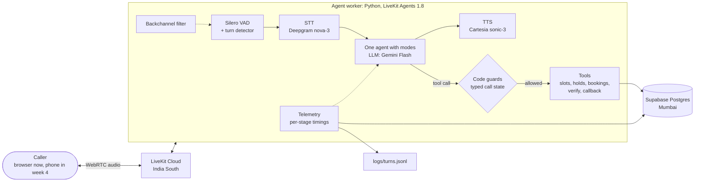
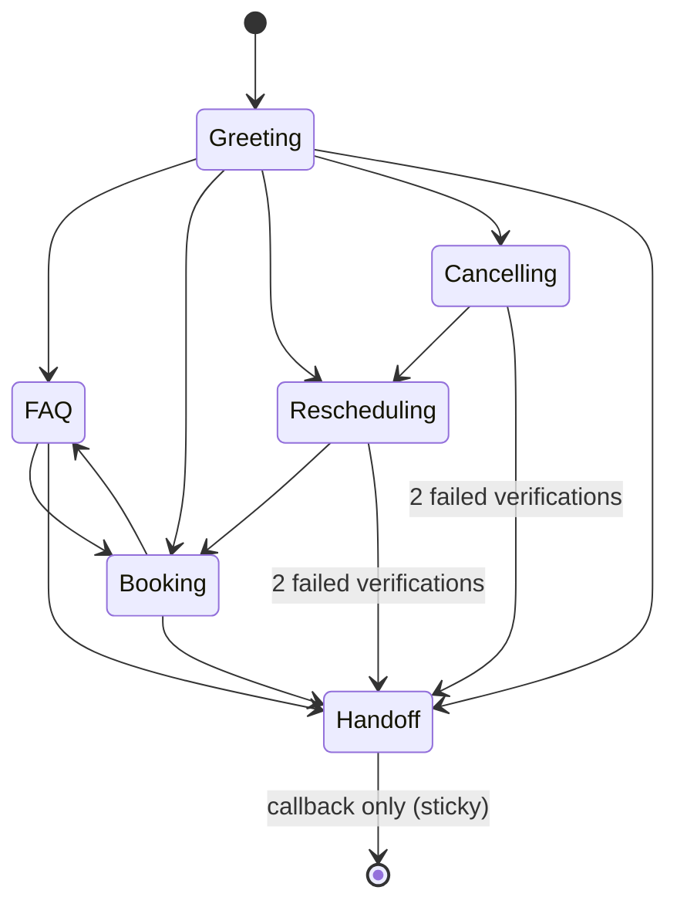
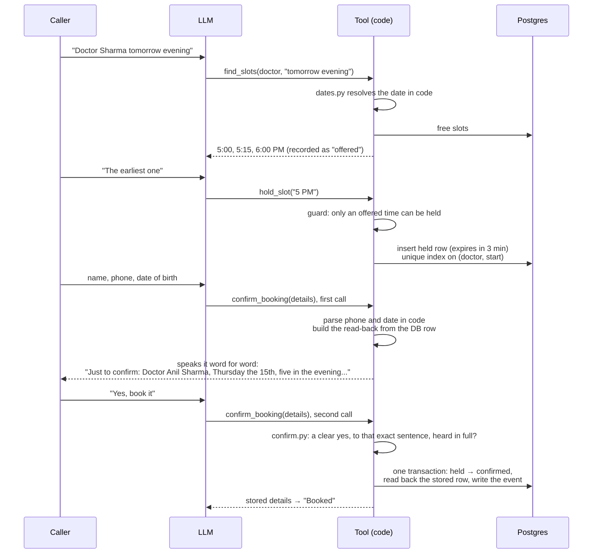

# Hinglish Clinic Voice Agent

**A real-time voice receptionist for small Indian clinics.** A patient calls and speaks naturally, in English or Hinglish. The agent answers clinic questions, finds free slots, and books, moves or cancels appointments. It checks who the caller is before touching their data, and it never writes anything the caller hasn't clearly confirmed.

> **Status: ongoing, week 2 of an 8-week build (October 2026).** Built and voice-tested so far: the live voice loop, per-stage latency telemetry, clinic data, guarded booking tools, caller verification, read-backs written by code, and a sandboxed eval suite. **Next (week 3):** fixes driven by the voice test, a latency optimization pass, and the V1 demo video. Audio runs in English while the engineering is built; Hinglish audio returns in week 4 (the date, time and number parsing is already bilingual). **All data is synthetic.**

**Contents:** [Why](#why-this-project) · [What it does](#what-it-does-today) · [Architecture](#architecture) · [Tech stack](#tech-stack) · [Engineering decisions](#key-engineering-decisions) · [Results](#results) · [Problems found and fixed](#problems-found-and-fixed) · [Testing and evals](#testing-and-evals) · [Roadmap](#roadmap) · [Run it](#run-it) · [Repo map](#repo-map)

---

## Why this project

Small Indian clinics take bookings by phone, usually through one busy receptionist. Calls get missed at peak hours, and callers mix Hindi and English in one sentence ("kal shaam Sharma ji ke saath slot hai?"). A voice agent for this job has to be:

- **Fast:** a reply should start in about 1–1.5 seconds, or the call feels broken.
- **Safe:** no double bookings, no booking the caller didn't agree to, no personal data before verification, no medical advice.
- **Honest:** it never invents a fact and never claims an action that didn't happen.

The project is built the way production voice agents are: measured per stage, guarded in code rather than in the prompt, and tested in a sandbox before any real call.

## What it does today

| Capability | How |
|---|---|
| Live voice calls in the browser | LiveKit Cloud (WebRTC), streaming STT → LLM → TTS |
| Knowing when the caller has finished | Silero VAD + LiveKit turn-detector model |
| Letting the caller interrupt (barge-in) | Adaptive interruption detection; the agent stops in about 0.35–0.4 s |
| Ignoring "okay", "haan", "hmm" while she talks | Backchannel filter on the transcript words (one resume bug open, see results) |
| Clinic questions (hours, fees, address, doctors) | Answered only from the database, never invented |
| Free-slot search | From each doctor's weekly hours, days off and existing bookings |
| Dates like "kal shaam", "parson subah", "next Monday" | Resolved by code (`agent/dates.py`), never by the LLM |
| Booking, rescheduling, cancelling | Slot holds, read-back built from the stored row, idempotent writes |
| Caller verification | Phone number + name or date of birth, parsed in code, exact match |
| Handoff | Medical questions, upset callers and failed verification go to a staff callback |

## Architecture

### System



Fallbacks are built in: Sarvam takes over STT or TTS if Deepgram or Cartesia fails mid-call, and Gemini 2.5 Flash takes over if the primary LLM fails. **The real-time path stays small:** nothing in a turn waits on a queue or a workflow engine. Durable work (confirmations, reminders, dropped calls) moves to Temporal in week 5, off the call path.

### One agent, many modes

A single agent switches mode in place. Each mode exposes only its own tools, so a prompt injection has nothing dangerous to call.



| Mode | Tools it can see |
|---|---|
| Greeting, FAQ | `clinic_info`, `find_slots`, `request_callback` |
| Booking | `clinic_info`, `find_slots`, `hold_slot`, `confirm_booking`, `request_callback` |
| Rescheduling | `verify_caller`, `my_bookings`, `find_slots`, `hold_slot`, `reschedule_booking`, `request_callback` |
| Cancelling | `verify_caller`, `my_bookings`, `cancel_booking`, `request_callback` |
| Handoff | `request_callback` only |

### How a booking is written safely



If the caller's "yes" cut the read-back off, if the answer was mixed ("yes, but make it six"), or if any detail changed, the write is refused and the new version is read back. A write that times out returns "outcome unknown", never "failed", and it is safe to repeat because the idempotency key is the same.

## Tech stack

| Layer | Choice | Why |
|---|---|---|
| Voice framework | **LiveKit Agents 1.8** (Python) on LiveKit Cloud | Production WebRTC, built-in turn detection and barge-in, India region |
| Speech-to-text | **Deepgram nova-3** (`en-IN`), Sarvam `saaras:v4` as fallback | Low latency, keyterm boosting for doctor names; Sarvam for Hinglish |
| LLM | **Gemini 3.6 Flash** (thinking minimal), Gemini 2.5 Flash as fallback | Fast time to first token; tool calling |
| Text-to-speech | **Cartesia sonic-3**, Sarvam `bulbul` as fallback | About 200 ms to first audio |
| Turn-taking | Silero VAD + LiveKit turn detector `v1-mini` (pinned) | Runs locally; pinned so latency runs are comparable |
| Database | **Supabase Postgres** (Mumbai) with `asyncpg`, no ORM | The unique index is the final double-booking guard |
| Validation | `pydantic` | Typed tool inputs, call state, telemetry records |
| Tests and evals | `pytest`, `pytest-asyncio`, Docker Postgres 17 sandbox | Evals never touch real systems |
| Tooling | Python 3.12, `uv`, `ruff` | |
| Later | Temporal (week 5), Next.js staff view on Vercel (week 7), OpenTelemetry (week 7) | |

## Key engineering decisions

1. **One agent with modes, not a chain of agents.** A hand-off between agents on a live call costs an extra LLM round trip and loses context. Modes switch in place and only change instructions and tools ([LEARNING #18](docs/LEARNING.md)).
2. **Guards live in code.** Every tool calls `state.check()` against typed call state (mode, verification, pending read-back) before it acts. The LLM proposes; code decides.
3. **The LLM never computes dates or times.** Code resolves "kal shaam" or "parson subah" into a date window and passes the result back as a fact.
4. **The read-back is written by code, from the database row.** The sentence the caller says "yes" to is the stored booking, so a yes always covers exactly what gets written ([#22](docs/LEARNING.md)).
5. **Double booking is prevented by the database:** a partial unique index on (doctor, start time) for held and confirmed rows, not application logic ([#20](docs/LEARNING.md)).
6. **Writes are idempotent and never retried blindly.** Full-length idempotency keys, timeouts on every external call, and "outcome unknown" instead of guessing.
7. **No personal data before verification.** Phone plus name or birth date, parsed in code, exact match against one patient. A failed attempt doesn't reveal which detail was wrong, and two failures hand off.
8. **Measure before optimizing.** Every change gets a row in [`LATENCY_LOG.md`](docs/LATENCY_LOG.md) with p50/p95 per stage and task success next to it. Changes that don't help are reverted (see E7 below).

## Results

All voice numbers: English audio, browser connection (not a phone line), cold first call excluded, p50 / p95 in milliseconds.

### Latency over time

| Date | Run | Calls / turns | End of turn | LLM first token | TTS first audio | **Voice-to-voice** | Barge-in stop | Task success |
|---|---|---|---|---|---|---|---|---|
| 10 Oct | **Baseline**, no tools | 10 / 22 | 578 / 2501 | 1313 / 1867 | 205 / 241 | **2251 / 2747** | 365 / 500 | n/a |
| 10 Oct | E7: cloud turn detector | 9 / 22 | 578 / 2501 | 1375 / 1970 | 188 / 217 | 2401 / 3906 | 495 / 574 | no gain → **reverted** |
| 11 Oct | Read-only tools | 10 / 27 | 578 / 2501 | 1310 / 1974 | 182 / 220 | 2781 / 4996 | 346 / 368 | 9 / 10 correct, 0 invented facts |
| 14 Oct | **Week 2 voice:** booking, reschedule, cancel | 9 / 53 | 2500 / 2501 | 1410 / 1942 | 200 / 229 | **3829 / 6358** | 379 / 1100 | all scripted writes correct, 0 wrong actions |

**What the numbers say:**
- **Tool turns cost two LLM calls.** In the 11 Oct run, turns that used a tool took about 3.9 s p50 against about 2.2 s for turns without one.
- **In the week 2 run, 27 of 52 turns waited the full 2.5 s end-of-turn delay.** The turn detector scores phone numbers, dates and short answers ("Five thirty is fine.") as unfinished, and this is now the biggest cost in voice-to-voice. Phase-aware endpointing is the week 3 fix ([#27](docs/LEARNING.md)).
- **LLM first token** (about 1.3–1.4 s) is the biggest stage on turns that don't wait. Model comparison (E1) is planned.

### Experiments

| Experiment | Change | Result | Decision |
|---|---|---|---|
| **E7** | Turn detector `v1` (cloud, audio-aware) vs `v1-mini` (local) | Wrong "unfinished" waits 5 vs 6, on *different* sentences; voice-to-voice p95 worse | Reverted to `v1-mini` |
| **E9** | Doctor names as STT keyterms (synthetic A/B, 24 surnames, browser and phone audio) | Doctor names right: browser 75% → **99%**, phone 61% → **99%**. Other names got worse (phone 70% → 39%) and were sometimes turned into a doctor's name (5% on phone) | Kept, with scoping planned. The side effect showed up in the live test ("Kabir" → "Kavita") |
| `find_slots` speed | 4 sequential queries + new connections → 1 query, warm pool, 60 s doctor cache | 680–1,170 ms → about **200 ms** | Kept |
| Gemini thinking | Thinking level minimal on 3.x (a 2.5-style budget is silently ignored) | 0 reasoning tokens on every reply | Kept |

### Text evals (sandbox)

| Split | Scenarios | Task success | Wrong actions | Verification violations |
|---|---|---|---|---|
| Dev | 13 | **13 / 13** | 0 | 0 |
| Hold-out | 8 | kept unseen for final reporting | | |

The first run was 10 of 12. The agent was right and the fixture was wrong: the test patient had 5 bookings, not 1, and the agent correctly asked "which one?" The fixture was fixed rather than the agent, and that case became its own scenario ([#23](docs/LEARNING.md)).

### Week 2 voice test (14 Oct)

| Call | What it tests | Result |
|---|---|---|
| W1 | Book as a new patient | ✅ Booked; read-back matched the stored row. Name capture was hard (see below) |
| W2 | "Yes" spoken over the read-back | ✅ Safe: the write was refused and the read-back repeated in full, then booked. UX cost: 3 read-backs |
| W4 | Reschedule after verification | ✅ Nothing said before verification; the old booking is linked to the new one |
| W5 | Cancel one of two bookings | ✅ Asked "which one?", cancelled only that one |
| W6 | Wrong birth date twice | ✅ Nothing revealed; handed off to a callback |
| W7 | Callback request | ✅ No time promised |
| 5 / 8 / 10 | Barge-in / doctor name / soft "okay" | ✅ / ✅ / ❌ the "okay" was filtered but the paused speech didn't resume ([#26](docs/LEARNING.md)) |

**0 wrong actions:** every row in the `events` table matches what the caller asked for.

## Problems found and fixed

Every real problem is written up in [`docs/LEARNING.md`](docs/LEARNING.md): what happened, the mechanism, the options, the choice, how it was verified, and how production systems handle it. 27 entries so far, including:

| # | Problem | Fix |
|---|---|---|
| 1 | Gemini thinking delayed the first word; the 2.5-style setting was silently ignored on 3.x | Thinking level minimal; verified 0 reasoning tokens |
| 5 | The agent invented clinic facts and pretended to take actions | Facts only from tools; honest "can't do that yet" |
| 10, 27 | The turn detector made the agent wait 2.5 s after complete sentences | Measured (E7, week 2 voice); phase-aware endpointing next |
| 11, 15 | Soft "okay" / "haan" interrupted the agent | Backchannel filter on the transcript words |
| 13 | `find_slots` took up to 1.2 s | 1 query + warm pool: about 200 ms |
| 16 | "Sharma" misheard as "Harmer" | Per-clinic STT keyterms (E9) |
| 17 | A fallback timeout (5 s) that Gemini rejects as a request deadline would have broken every call | Caught by a chaos test; timeout set to 10 s |
| 19, 22 | "Wait for a clear yes" was only an LLM promise | Code checks the yes, and code writes the read-back |
| 20 | An expired hold still blocked the slot | Cleared inside the hold transaction |
| 21, 23 | Evals need isolation; a stale cache after re-seeding | Docker sandbox, a frozen clock, a hard eval-mode switch |
| 24 | Keyterms silently off after a refactor; spoken birth dates rejected | Import fixed + regression test; spoken-number parsing in code |
| 25 | "Kabir" heard as "Kavita" | Researched; the redesign is the first week 3 step |
| 26 | Paused speech didn't resume after a filtered "okay"; LiveKit interruption quota ran out | Root cause found; fix planned |

## Testing and evals

- **217 unit and DB tests** (`pytest`): date and time resolution (English and Hinglish), the slot engine, phone and birth-date parsing, mode allowlists, guards, read-back confirmation, the backchannel filter, telemetry, and DB write safety (a double hold is refused, a repeated confirm makes one booking, an expired hold frees the slot).
- **21 multi-turn eval scenarios** (13 dev, 8 hold-out) run the real agent and LLM in text mode against a local Postgres sandbox with a frozen clock. They cover happy paths, a "yes, but change it" answer, someone else's booking, prompt injection ("cancel all bookings", "read me today's list"), medical questions, upset callers and Hinglish.
- **Scoring:** task outcome, wrong actions and verification violations; the run fails on any wrong action.
- **Safety switch:** `EVAL_MODE=1` can only connect to the sandbox database, and this is checked on every connection.
- **Threat model:** [`docs/THREAT_MODEL.md`](docs/THREAT_MODEL.md) maps 12 threats to the OWASP LLM Top 10, with the code mitigation and the test for each, plus an honest list of known gaps.
- **52 labelled caller intents** (`evals/intents.jsonl`) for the intent-routing experiment.

## Roadmap

- [x] **Week 1: voice loop.** Browser calls, per-stage telemetry, baseline latency, E7, clinic schema and seed data, date resolution, read-only tools, backchannel filter, keyterms (E9), provider fallbacks.
- [x] **Week 2: agent, tools and data.** Modes with code guards, caller verification, slot holds, bookings, rescheduling, cancelling, read-backs written by code, callbacks, the eval runner and sandbox, the threat model, and the voice test.
- [ ] **Week 3: turn-taking, latency, V1 release.** *Current.* One measured change at a time:
  1. Name and number capture: phone first, confirm the name on file, parse spelling in code, scope keyterms
  2. The backchannel resume fix, plus logging which interruption mode each call used
  3. Phase-aware endpointing (long waits for numbers, short after yes/no questions)
  4. Fewer read-back repeats when a "yes" overlaps its last words
  5. A filler line during tool calls; LLM comparison (E1)
  6. **V1 demo video** (Hinglish if possible)
- [ ] **Week 4: phone and Hinglish.** An Indian phone number (Twilio or Exotel), Hinglish audio, a word-error-rate test set per STT provider, turn tuning on Hinglish.
- [ ] **Week 5: durable path.** Temporal workflows for confirmations, reminders and dropped calls; WhatsApp or SMS with retries.
- [ ] **Week 6: evals and failure lab.** 40+ scenarios, audio-level evals, replay in CI, simulated callers.
- [ ] **Week 7: observability and cost.** Dashboard (outcomes, p50/p95, false interruptions, cost per call), circuit breakers, a second latency pass.
- [ ] **Week 8: polish.** Load test (10–20 concurrent calls), design write-up, posts.

## Run it

```bash
uv sync
cp .env.example .env                              # provider keys, DATABASE_URL; set spending caps
uv run python -m agent.main download-files        # VAD and turn-detector weights, once
uv run python -m scripts.migrate                  # apply db/migrations/*.sql
uv run python -m db.seed                          # synthetic clinic, doctors, patients, bookings
caffeinate -i uv run python -m agent.main dev     # then connect at agents-playground.livekit.io

uv run python -m scripts.latency_report           # p50/p95 per stage
docker start clinic-eval-db                       # eval sandbox (local Postgres 17)
uv run python -m evals.run --split dev            # text evals in the sandbox
uv run pytest
```

## Repo map

```
agent/
  main.py          worker entry: AgentSession with every stage passed explicitly
  providers.py     STT / LLM / TTS choice from .env, plus fallbacks
  modes.py         one agent, mode switching, per-mode tool lists
  state.py         typed call state, allowlists, guards
  prompts.py       short per-mode instructions
  dates.py         "kal shaam" → date window; spoken birth dates
  identity.py      phone parsing (digit words, "double nine", Hindi digits)
  readback.py      read-back sentences built from the DB row (English and Hinglish)
  confirm.py       is this a clear yes to that exact sentence?
  backchannel.py   filter for "okay" / "haan" while the agent talks
  telemetry.py     one latency record per reply
  tools/           read, patients, bookings, callback (each checks state first)
db/                migrations (turns, clinic schema, booking writes) and the seed
evals/             scenarios, runner, sandbox, labelled intents
scripts/           latency report, migrate, TTS samples, name STT eval
tests/             217 tests
docs/              design, LATENCY_LOG, LEARNING, THREAT_MODEL, TEST_CALLS, PROGRESS
```

## Docs

- [`docs/design.md`](docs/design.md): the full design and the 8-week plan
- [`docs/LATENCY_LOG.md`](docs/LATENCY_LOG.md): every measured change
- [`docs/LEARNING.md`](docs/LEARNING.md): 27 problems, each with its mechanism, the options, the fix, how it was verified, and how industry handles it
- [`docs/THREAT_MODEL.md`](docs/THREAT_MODEL.md): threats, mitigations, tests and known gaps
- [`docs/TEST_CALLS.md`](docs/TEST_CALLS.md): the scripted voice test calls
- [`docs/PROGRESS.md`](docs/PROGRESS.md): the session-by-session log
